<p align="center">
  
</p>

<p align="center">
  
  
  
  
</p>

<p align="center">✦ · ˚ ⋆ · ✧ · ˚ ⋆ · ✦</p>

### ✦ Sobre mí

```python
class Notfulii:
    def __init__(self):
        self.pais = "Colombia 🇨🇴"
        self.universidad = "Escuela Colombiana de Ingeniería Julio Garavito"
        self.carrera = "Ingeniería en Ciberseguridad"
        self.idiomas = {"Español": "Nativo", "English": "B1+"}
        self.aprendiendo = ["Python"]
        self.proximamente = ["SQL", "Docker", "Java", "C++", "HTML", "y mucho más..."]

    def mision(self):
        return "Aprender todos los días y construir cosas seguras 🔐"
```

<p align="center">✦ · ˚ ⋆ · ✧ · ˚ ⋆ · ✦</p>

### ✦ Stack

**🔵 Aprendiendo ahora**

<p align="left">
  
</p>

**🔜 En la lista**

<p align="left">
  
</p>

<p align="center">✦ · ˚ ⋆ · ✧ · ˚ ⋆ · ✦</p>

### ✦ Proyectos

<p align="left">
  <a href="https://github.com/notfulii/PokeFIGHT">
    
  </a>
</p>

> 🎓 **PokeFIGHT**: proyecto académico en Python y Pygame. Consume datos de PokéAPI, tiene cuentas con contraseñas hasheadas, rankings y corre en Docker.

<p align="center">✦ · ˚ ⋆ · ✧ · ˚ ⋆ · ✦</p>

### ✦ Estadísticas

<p align="center">
  
  
</p>

<p align="center">
  
</p>

<p align="center">✦ · ˚ ⋆ · ✧ · ˚ ⋆ · ✦</p>

<p align="center">
  
</p>


